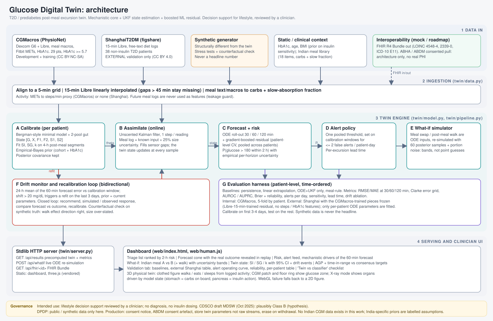

# Glucose Digital Twin: T2D / prediabetes post-meal excursions

Happiest Health Digital Twin Challenge 2026 submission.

**Team / college:** Tanmay Narnaware · _[college, department, year, team members and clinical advisor: fill in before submitting]_
**Architecture diagram:** [docs/architecture.pdf](docs/architecture.pdf) (source: [docs/architecture.svg](docs/architecture.svg))
**Video:** _[link]_ · **Deck:** _[link]_ · **License:** MIT (code), see [LICENSE](LICENSE) for dataset licenses



## What it is

A per-patient digital twin of post-meal glucose for people with prediabetes or type 2 diabetes. For each patient it keeps a
**latent physiological state** (glucose, insulin action, two gut pools), **calibrates** per-patient parameters with uncertainty,
**updates the state at every CGM reading**, **forecasts** 30/60/120 minutes ahead with the probability of exceeding 180 mg/dL,
**re-simulates what-ifs** (an Indian meal swap, a post-meal walk) through the same ODE, and **recalibrates itself** when its forecast
error drifts. A clinician dashboard (AGP, triage, forecast cone, what-if, twin state) and a 3D "physical twin" show it working.

Intended use is lifestyle decision support reviewed by a clinician. It does not diagnose and does not dose insulin.

### Twin, not a classifier

| Test | Relabeled classifier | This prototype |
|---|---|---|
| State | static feature vector | explicit state `[G, X, F1, F2, S1, S2]` updated by a UKF at every reading |
| Personalisation | one global model | per-patient insulin sensitivity SI, glucose effectiveness SG, absorption k, with posterior width; HbA1c-informed prior shrunk toward the cohort |
| Bidirectional | outputs a risk score | forecast error is monitored; a 24 h shift above 20 mg/dL triggers a refit on the last 3 days |
| What-if | slider re-runs a classifier | meal and walk are ODE inputs; bands from 60 posterior samples plus portion-size noise |
| Validation | random-split accuracy | patient-level, time-ordered, baselines, error grid, external dataset, alerts per day |

Boxes it does **not** tick yet are listed under [Limitations](#limitations).

## Quick start

```bash
pip install -r requirements.txt            # numpy, scipy, scikit-learn, xlrd, openpyxl
python3 test_twin.py                       # self-check: gut mass balance, parameter recovery, error grid
python3 fetch_cgmacros.py                  # CGMacros CSVs only (not the photos), ~45 MB via range requests
python3 fetch_shanghai.py                  # ShanghaiT2DM, 3.4 MB
python3 run.py --cgmacros data/cgmacros    # builds the twin (~2 min incl. external validation) and serves the dashboard
python3 run.py --serve                     # serve an existing out/ without rebuilding
python3 run.py                             # no downloads needed: 12 synthetic patients (stress test only)
```

Open <http://localhost:8765>. Press **Replay**, click a patient, change the meals in **What-if**, tick **X-ray** on the body.
`http://localhost:8765/?no3d` forces the 2D fallback figure if WebGL is unavailable.
Only numpy and scipy are needed for the twin itself; scikit-learn is used for the boosted residual and the Shanghai loaders need xlrd/openpyxl.
If the port is busy, stop any older server first (`lsof -ti :8765 | xargs kill`).

## Method

1. **Model** (`twin/model.py`): Bergman-style minimal model with a two-pool gut (fast and slow absorption, slow fraction from fat/protein/fibre) and an exercise term. Fixed constants (remote-insulin rate, mg/dL per gram of carbohydrate, exercise gain, slow-pool ratio) are assumptions, flagged in code.
2. **Calibration**: least squares on 4-hour post-meal segments with a robust loss; prior = cohort mean (empirical Bayes) shifted by HbA1c; the Gaussian posterior covariance is kept and sampled for what-ifs.
3. **State estimation**: unscented Kalman filter over the six states; meal logs are known inputs with 25% size uncertainty; the filter bridges sensor gaps.
4. **Forecast**: ODE roll-out from the filtered state plus a gradient-boosted residual (features: filtered state, glucose trend and lags, time of day, time since and size of recent meals, activity, HbA1c). Per-horizon forecast uncertainty is empirical; `P(>180 mg/dL within 2 h)` takes the maximum over horizons.
5. **Alerts**: one pooled threshold chosen on calibration windows for at most 2 false alerts per patient-day; alerts only fire from below 180.
6. **Drift and recalibration**: 24 h mean of the signed 60-minute forecast error versus the calibration window; shift above 20 mg/dL refits on the last 3 days.
7. **What-if** (`twin/server.py`): meal and walk enter the ODE; 60 posterior samples give 5/50/95% bands. No ML correction is applied to what-ifs.
8. **Interoperability**: FHIR R4 Bundle per patient (`/api/fhir/<id>`; ICD-10 E11, LOINC 4548-4 and 2339-0), mock data only.

## Data

| Dataset | Use | Notes | License |
|---|---|---|---|
| CGMacros (PhysioNet) | development and internal validation | 29 US adults with HbA1c >= 5.7 (prediabetes + T2D), at least 10 days; Dexcom G6, meal macros from photos, Fitbit METs | CC BY-NC-SA 4.0 |
| ShanghaiT2DM (figshare) | external validation | 38 non-insulin patients, 15-min Libre (interpolated to 5 min), free-text diet logs converted to carbs by a crude keyword table | CC BY 4.0 |
| Synthetic generator (`twin/data.py`) | stress tests, counterfactual check | structurally different from the twin; never a headline number | n/a |

CGMacros's non-commercial license applies to anything trained on it. No Indian CGM data was available; every India-specific element
(thin-fat HbA1c prior, the 18-item meal library with approximate carbs) is a labelled assumption to verify against IFCT 2017.

## Results

All numbers are from `out/results.json` (reproducible with the commands above). RMSE in mg/dL; split by patient and time: calibrate on the
first 3 to 4 days, test on the rest.

**Internal: CGMacros, 29 patients, 5-fold by patient for the boosted residual**

| Horizon | Persistence | Linear extrap. | ODE + UKF only | Hybrid |
|---|---|---|---|---|
| 30 min | 20.6 | 27.2 | 26.1 | **18.3** |
| 60 min | 31.1 | 50.9 | 32.4 | **26.1** |
| 120 min | 42.8 | 84.2 | 38.6 | **32.4** |

Excursion AUROC (glucose above 180 mg/dL within 2 h, 19% prevalence): persistence 0.69, linear 0.67, meal-rule baseline 0.57, ODE + UKF 0.73, **hybrid 0.81**; Brier 0.121.
Clarke zones A+B at 120 min: 98.5% hybrid versus 97.0% persistence.

**External: ShanghaiT2DM, 38 patients, CGMacros-trained components frozen**

| Horizon | Persistence | ODE + UKF only | Hybrid |
|---|---|---|---|
| 30 min | 16.4 | 20.2 | **13.2** |
| 60 min | 27.7 | 27.3 | **22.7** |
| 120 min | 40.6 | 34.6 | **30.9** |

Excursion AUROC (11% prevalence): persistence 0.72, linear 0.76, **hybrid 0.845**. Clarke A+B at 60 min is about equal to persistence, so no clinical-safety gain is shown.
Our first attempt (Dexcom-trained ridge) barely beat persistence on Shanghai (60 min RMSE 26.2, AUROC 0.745). The transfer model matched the target's
conditions instead: trained on CGMacros's Libre readings subsampled to 15 minutes, no steps or HbA1c features. It was selected by leave-patients-out CV on CGMacros
only and evaluated once on Shanghai.

**Alerts** (pooled threshold, per excursion; lead is capped by the 2 h horizon)

| | CGMacros | ShanghaiT2DM |
|---|---|---|
| False alerts per patient-day | 2.2 | 2.3 |
| Excursions warned | 88% | 98% |
| Warned with at least 15 min notice | 73% | 88% |
| Median lead | 45 min | 45 min |

**Other checks**
- Drift: on real data the monitor fired 28 times across 10 patients; recalibration gave only a small gain (60 min RMSE 33.0 vs 33.4 without). On synthetic patients with a deliberate insulin-sensitivity drop it helped more (34 vs 40).
- Counterfactual (synthetic ground truth): the twin predicts a 15-min post-dinner walk lowers the 3 h peak by 2.3 mg/dL; truth is 1.6 (r = 0.58). Direction right, size over-stated, because the exercise constant is an assumption.

## Repository layout

```
twin/data.py        meal library, synthetic generator, CGMacros + ShanghaiT2DM loaders, FHIR export
twin/model.py       ODE, calibration, UKF, drift monitor, residual features/models
twin/pipeline.py    per-patient twin, CV residuals, evaluation, alert policy, external validation, JSON export
twin/server.py      stdlib HTTP server: dashboard, /api/results, /api/whatif, /api/fhir/<id>
web/index.html      clinician dashboard;  web/human.js  3D physical twin (three.js vendored in web/vendor)
run.py              build + serve;  test_twin.py  self-check
fetch_cgmacros.py, fetch_shanghai.py   dataset download helpers
docs/               architecture diagram (SVG, PDF) and its generator
out/                generated results.json and state.pkl;  out_synthetic/  earlier synthetic run
```

## Limitations

- Small cohorts (29 and 38 patients), US and Chinese, no Indian CGM data. Meal carbs come from photo-based estimates (CGMacros) and a keyword table (Shanghai).
- On CGMacros the ODE alone is no better than persistence at 30 and 60 minutes; most of the skill comes from the boosted residual, and on Shanghai the Clarke safety zones do not improve.
- Calibrated parameters sometimes sit at their bounds, so per-patient identifiability from noisy logs is the main scientific risk.
- The drift monitor is trigger-happy on real data and the residual model is not retrained after a recalibration.
- The CGMacros headline rows use residual models trained on other patients but the same cohort; there is no independent second CGMacros-like cohort.
- No insulin or medication input; non-insulin visits only. Activity in CGMacros is a METs-to-steps proxy.
- Not done: clinician review of thresholds and wording, prospective validation, a Chronos/TimesFM or LightGBM baseline, a real ABDM consent flow.
- The earlier 5-minute median lead time was a measurement artifact; the current figures are per excursion.

## Governance

- **Regulatory (hypothesis):** CDSCO draft Medical Device Software guidance (Oct 2025, still draft) would plausibly place a clinician-facing, non-critical-condition tool in Class B. FDA SaMD / IMDRF and EU MDR Rule 11 are reference points. No claim of approval or clinical validity.
- **Privacy (DPDP Rules, notified Nov 2025, main obligations from 13 May 2027):** this repo uses public or synthetic data only. For production: purpose-specific consent notice, ABDM consent artefact, store twin parameters rather than raw streams, erasure on withdrawal.
- **Alert fatigue:** the dashboard shows the mechanistic drivers (meals on board, insulin action, ML correction) next to the risk, but alerts do not yet carry formal reason codes; the operating curve in the Validation tab shows the false-alert cost of earlier warning.

## Deploy

`Dockerfile` and `render.yaml` run the prebuilt dashboard (`out/` is committed; no datasets needed at runtime). On Render: New + > Blueprint > pick this repo.
The server reads `PORT` and binds `0.0.0.0` when it is set. `out/` contains results derived from CGMacros (CC BY-NC-SA 4.0): attribution to the CGMacros authors and non-commercial use apply.
